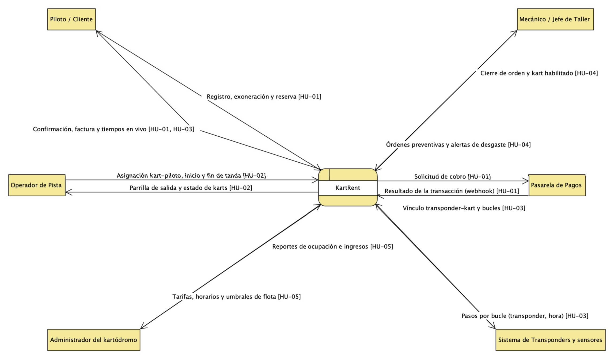
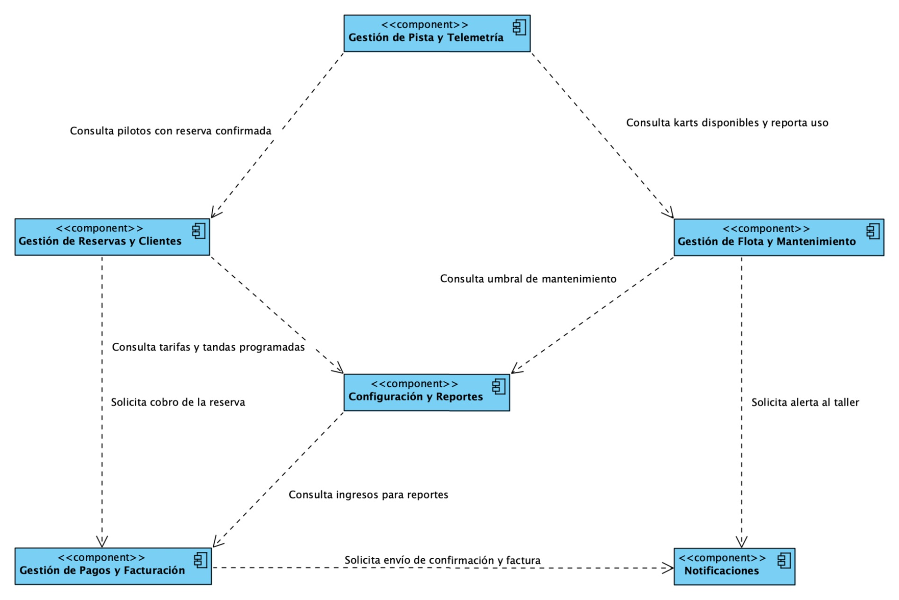
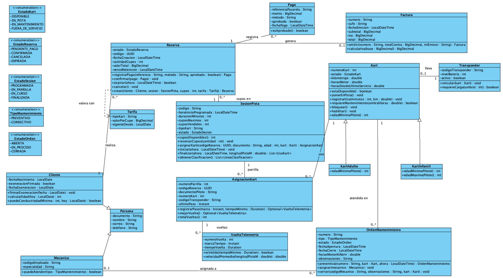
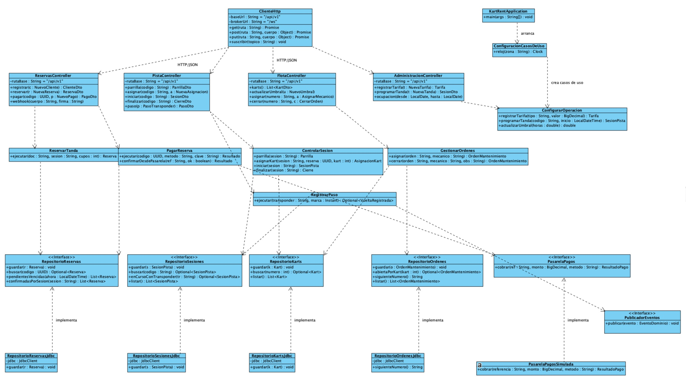
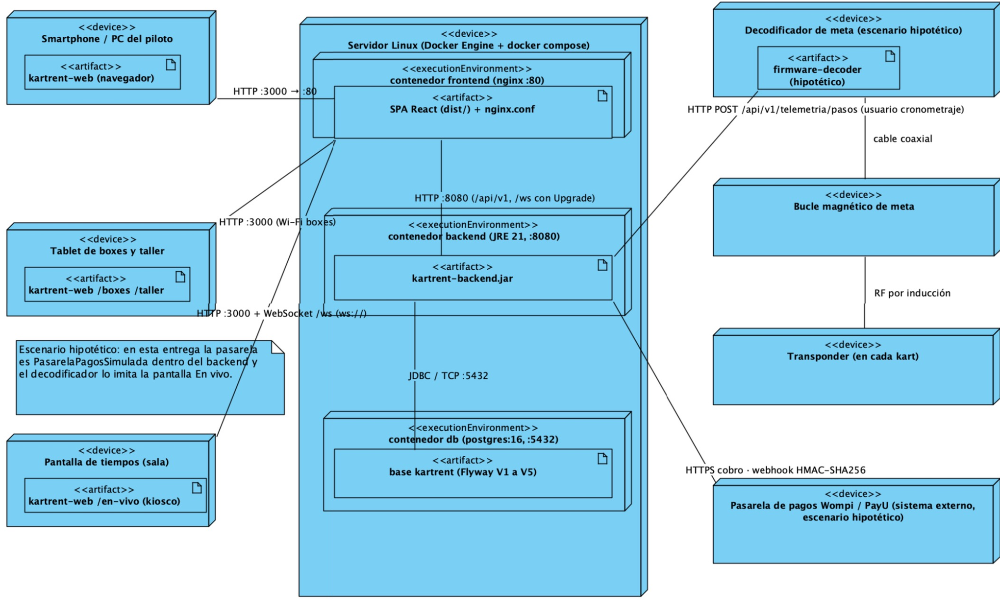

# KartRent — Sistema Integral de Renta y Gestión Operativa de Karting

Proyecto final de **Diseño de Software** (grupo 5B). Daniel Chaux.

KartRent cubre todo el día de un kartódromo:

- el piloto reserva y paga en línea;
- el jefe de boxes arma la parrilla con karts en buen estado;
- los transponders cronometran cada vuelta en vivo;
- el taller recibe órdenes preventivas automáticas;
- el administrador mide la ocupación.

| Capa | Tecnología |
| --- | --- |
| Frontend | React 19 + TypeScript + Vite, WebSocket STOMP |
| Backend | Java 21, Spring Boot 3.3 (REST, WebSocket, Scheduling, Actuator, OpenAPI) |
| Persistencia | PostgreSQL 16 con migraciones Flyway (H2 en modo PostgreSQL para pruebas) |
| Pruebas | Cucumber (Gherkin en español), JUnit 5, MockMvc |
| Operación | Docker Compose, Nginx, GitHub Actions |

## Ejecutar

```bash
docker compose up --build
```

| Qué | Dónde |
| --- | --- |
| Aplicación web | http://localhost:3000 |
| API y Swagger | http://localhost:8080/swagger-ui.html |
| Salud | http://localhost:8080/actuator/health |

Desarrollo sin Docker:

```bash
cd backend && mvn spring-boot:run          # H2 en memoria, datos de ejemplo
cd frontend && npm install && npm run dev  # http://localhost:5173 (proxy a :8080)
```

Pruebas: `cd backend && mvn verify` ejecuta los escenarios Gherkin de HU-01 a HU-05, las pruebas de dominio y la prueba de integración de punta a punta.

## Recorrido de demostración (5 minutos)

1. **Reservar (HU-01).**
   - Documento `1085000001` → elegir una tanda → reservar 2 cupos. Quedan retenidos 10 minutos (RN-01).
   - Pagar con tarjeta → factura con IVA y CUFE.
   - «Simular rechazo» muestra el pago rechazado.
2. **Boxes (HU-02).**
   - Elegir la tanda y asignar karts. El kart 7 está en mantenimiento y no aparece (RN-04).
   - Iniciar la tanda.
3. **En vivo (HU-03).**
   - «Simular carrera»: la tabla se actualiza por WebSocket.
   - Las lecturas de menos de 25 s se descartan (RN-07); el orden es por mejor vuelta (RN-08).
4. **Boxes → Finalizar.**
   - El kart 3 (19,9 h) supera el umbral de 20 h y se abre una orden preventiva (RN-09).
5. **Taller (HU-04).**
   - Asignar la orden a `M-02`.
   - Si cierra `M-01`, se rechaza (RN-10). Si cierra `M-02`, el kart vuelve a DISPONIBLE con el contador en 0.
6. **Administración (HU-05).** Tarifas, tandas, umbral y gráfico de ocupación (RN-13).

## Arquitectura (modelo 4+1)

Las fuentes PlantUML están en [`diagramas/plantuml`](diagramas/plantuml). La CI publica los PNG y SVG como artefacto, y los diagramas también se dibujaron en Visual Paradigm.

| Vista | Archivo | Qué muestra |
| --- | --- | --- |
| Contexto | `01_contexto.puml` | Actores y sistemas externos, con cada flujo etiquetado con su HU |
| Funcional | `02_funcional.puml` | Seis componentes de negocio y sus dependencias etiquetadas (sin infraestructura) |
| Lógica | `03_logica.puml` | Modelo de dominio con multiplicidades, herencia, clase abstracta y enumeraciones |
| Desarrollo | `04_desarrollo.puml` | Clases de implementación: controladores → casos de uso → puertos ← adaptadores |
| Despliegue | `05_despliegue.puml` | Contenedores nginx, Spring Boot y PostgreSQL, decodificador de meta y pasarela |

### Diagramas en Visual Paradigm

Proyecto [`diagramas/KartRent.vpp`](diagramas/KartRent.vpp) (se abre con Visual Paradigm); las imágenes están en [`diagramas/img`](diagramas/img).

#### 1. Vista de contexto
Actores humanos y sistemas externos que intercambian información con KartRent. Cada flujo lleva la historia de usuario que lo origina (`[HU-01]` … `[HU-05]`), para trazar requisitos → arquitectura.



#### 2. Vista funcional (componentes)
Seis componentes `<<component>>` que agrupan responsabilidades de negocio. Cada dependencia (línea punteada) dice qué servicio o información necesita un componente de otro, por ejemplo *Gestión de Reservas y Clientes → Solicita cobro de la reserva → Gestión de Pagos y Facturación*. Las bases de datos, la pasarela y el decodificador no aparecen aquí porque son infraestructura y se muestran en las vistas de contexto y despliegue.



#### 3. Vista lógica (modelo de dominio)
Clases del paquete `co.kartrent.dominio` con atributos, operaciones, asociaciones con nombre y **multiplicidad** (p. ej. una `Reserva` registra `0..*` pagos y genera `0..1` factura), herencia (`Persona` es **abstracta**; `Cliente` y `Mecanico` heredan de ella; `KartAdulto` y `KartInfantil` de `Kart`) y las enumeraciones `EstadoKart`, `EstadoReserva`, `EstadoSesion`, `TipoMantenimiento` y `EstadoOrden`.



#### 4. Vista de desarrollo (clases de implementación)
Clases reales del código y cómo se conectan: `ClienteHttp` (frontend) llama por HTTP/JSON a los controladores REST (cada uno con su `rutaBase`); los controladores invocan los casos de uso (`ReservarTanda`, `PagarReserva`, `ControlarSesion`, `RegistrarPaso`, `GestionarOrdenes`, `ConfigurarOperacion`); los casos de uso dependen solo de puertos `<<Interface>>` (`RepositorioReservas`, `RepositorioSesiones`, `RepositorioKarts`, `RepositorioOrdenes`, `PasarelaPagos`, `PublicadorEventos`), y los adaptadores de infraestructura (`Repositorio*Jdbc`, `PasarelaPagosSimulada`) **implementan** esos puertos. `KartRentApplication` arranca `ConfiguracionCasosDeUso`, que crea los casos de uso (inyección de dependencias). Así las dependencias siempre apuntan hacia el núcleo.



#### 5. Vista de despliegue
Dispositivos de usuario, servidor Docker (frontend, backend y PostgreSQL), hardware de cronometraje y pasarela de pagos.



### Estructura del código

```text
backend/src/main/java/co/kartrent
├── dominio/          ← núcleo: entidades y reglas (sin Spring, sin SQL)
├── aplicacion/       ← casos de uso (Controlador GRASP) + puertos (interfaces)
├── infraestructura/  ← adaptadores: JDBC, pasarela, eventos→WebSocket, config
└── presentacion/     ← controladores REST, DTOs, errores RFC 7807
```

### Patrones GRASP en el código

| Patrón | Dónde |
| --- | --- |
| Experto en información | `SesionPista.obtenerClasificacion()`, `Kart.requiereMantenimiento()`, `Cliente.calcularEdad()` |
| Creador | `SesionPista.asignarKart()` crea `AsignacionKart`; `Reserva.registrarPago()` crea `Pago` |
| Controlador | Un caso de uso por intención: `ReservarTanda`, `ControlarSesion`, `RegistrarPaso`, … |
| Polimorfismo | `KartAdulto` / `KartInfantil` → `edadMinimaPiloto()` |
| Fabricación pura | `PasarelaPagosSimulada`, `Repositorio*Jdbc`, `DifusorTiemposEnVivo` |
| Indirección / Variaciones protegidas | Puertos `PasarelaPagos`, `PublicadorEventos`, `Notificador`, `UnidadDeTrabajo` |
| Bajo acoplamiento | `AsignacionKart` guarda `codigoReserva`, no la `Reserva`; no hay ciclos entre módulos |

## Trazabilidad historia → código

| HU | Endpoints | Caso de uso | Prueba |
| --- | --- | --- | --- |
| HU-01 | `POST /clientes`, `POST /reservas`, `POST /reservas/{c}/pagos`, `POST /pagos/webhook` | `RegistrarCliente`, `ReservarTanda`, `PagarReserva`, `ExpirarReservas` | `HU01_reservar_y_pagar.feature` |
| HU-02 | `GET /sesiones/{c}/parrilla`, `POST …/asignaciones`, `…/iniciar`, `…/finalizar` | `ControlarSesion` | `HU02_boxes_parrilla.feature` |
| HU-03 | `POST /telemetria/pasos`, `GET …/clasificacion`, STOMP `/topic/sesiones/{c}/clasificacion` | `RegistrarPaso` | `HU03_cronometraje.feature` |
| HU-04 | `GET /flota/karts`, `POST /ordenes/{n}/asignacion`, `…/cierre` | `RegistrarUso`, `GestionarOrdenes` | `HU04_mantenimiento.feature` |
| HU-05 | `POST /tarifas`, `POST /sesiones`, `PUT /flota/umbral`, `GET /reportes/ocupacion` | `ConfigurarOperacion`, `ReporteOcupacion` | `HU05_administracion.feature` |

Las historias completas, con sus reglas de negocio y criterios Gherkin, están en [`docs/historias-de-usuario.md`](docs/historias-de-usuario.md).

## Detalles adicionales

- **Pago idempotente.** La cabecera `Idempotency-Key` evita cobrar dos veces.
- **Webhook firmado.** La firma es HMAC-SHA256 (`X-Firma`) y se compara en tiempo constante.
- **Expiración automática.** Una tarea `@Scheduled` libera los cupos de las reservas no pagadas.
- **Errores como Problem Details (RFC 7807).** Una regla de negocio incumplida responde 422; un dato inválido, 400.
- **Transacciones sin acoplar el núcleo a Spring.** Cada caso de uso corre en una transacción mediante el puerto `UnidadDeTrabajo`.
- **Clasificación en vivo.** Se publica después del commit (`@TransactionalEventListener`).
- **Factura electrónica simulada.** Desglosa el IVA del 19 % y calcula un CUFE con SHA-384.
