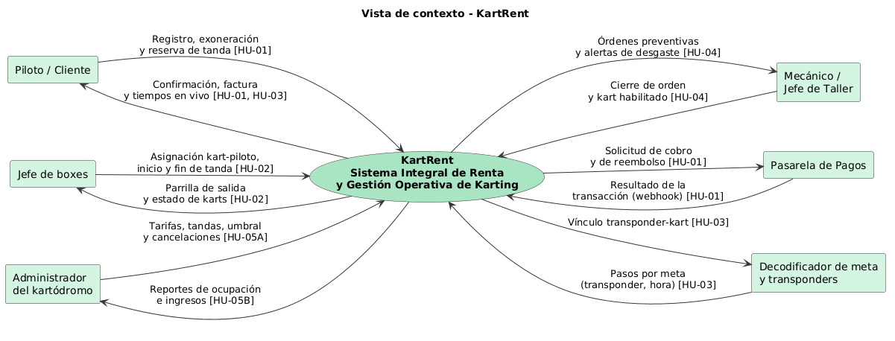
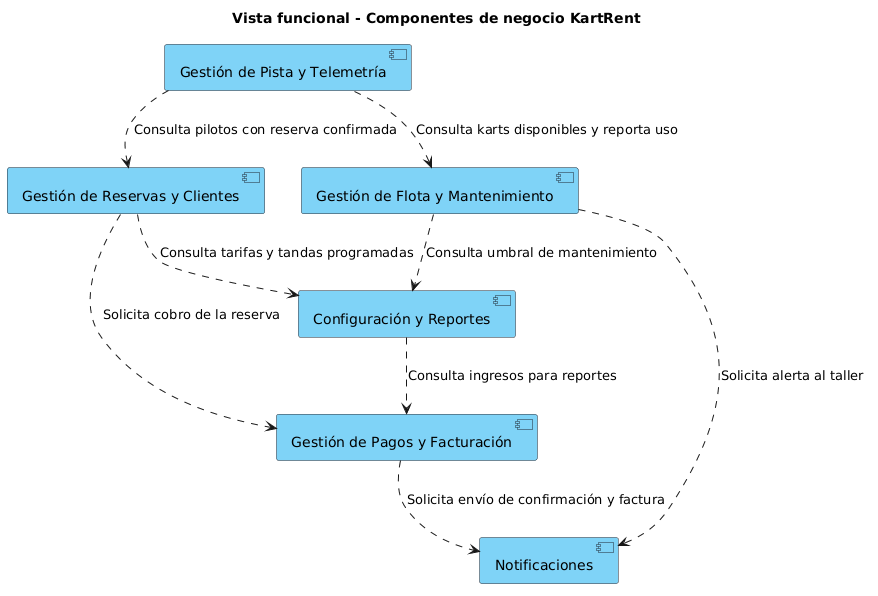
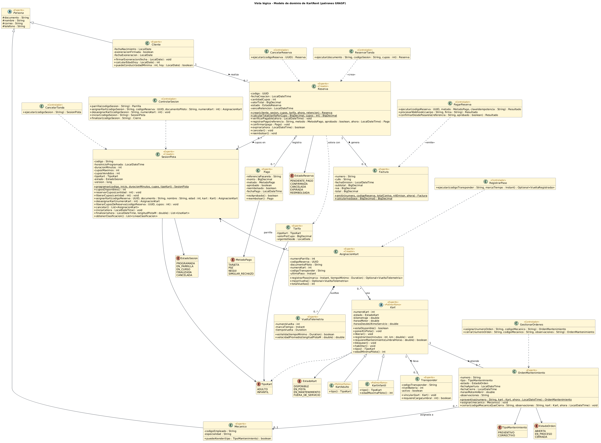
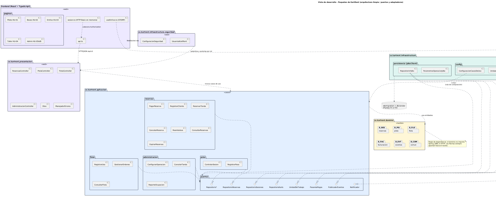
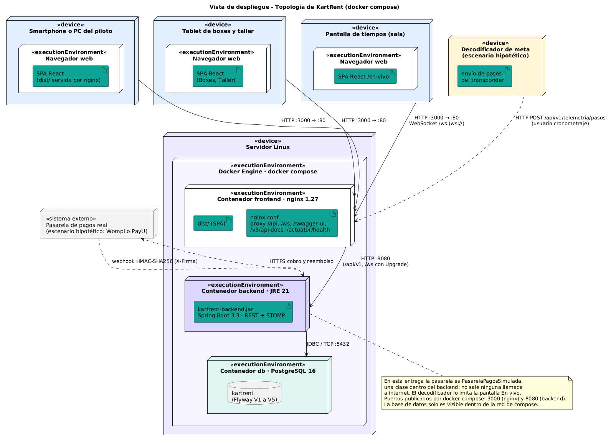
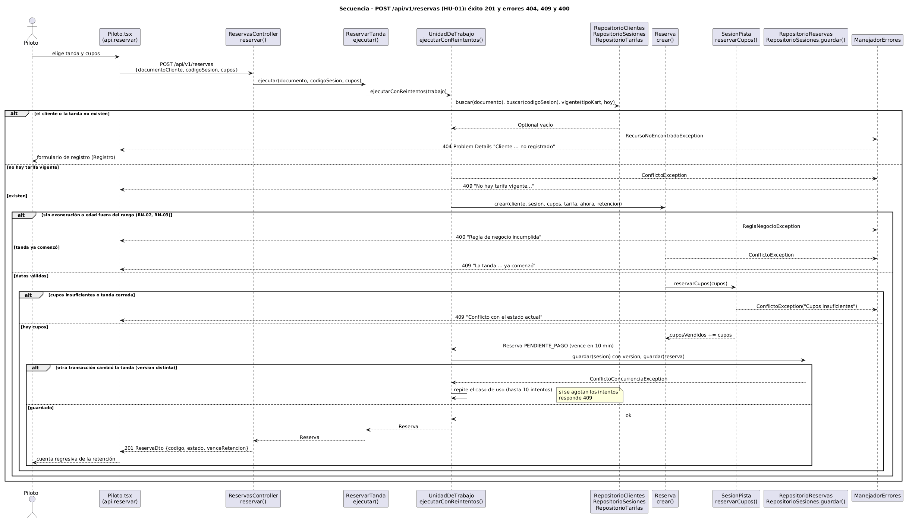
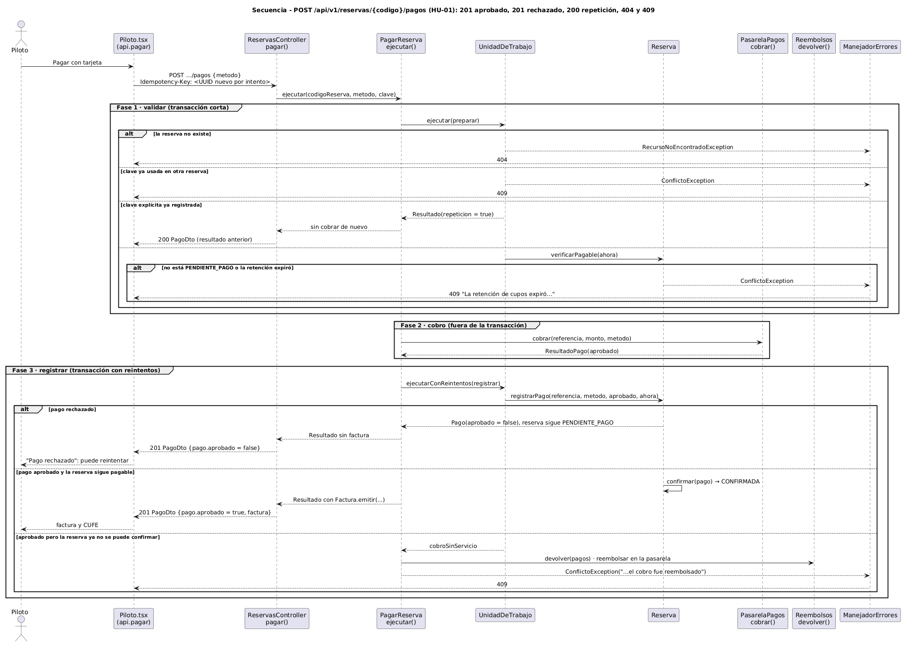

# KartRent — Sistema Integral de Renta y Gestión Operativa de Karting

Proyecto final de **Diseño de Software** (grupo 5B). Daniel Chaux.

KartRent cubre todo el día de un kartódromo:

- el piloto reserva y paga en línea;
- el jefe de boxes arma la parrilla con karts en buen estado;
- los transponders cronometran cada vuelta en vivo;
- el taller recibe órdenes preventivas automáticas;
- el administrador mide la ocupación.

| Capa | Tecnología |
| --- | --- |
| Frontend | React 19 + TypeScript + Vite, WebSocket STOMP, pruebas con Vitest y Testing Library |
| Backend | Java 21, Spring Boot 3.3 (REST, Security, WebSocket, Scheduling, Actuator, OpenAPI) |
| Persistencia | PostgreSQL 16 con migraciones Flyway (H2 en modo PostgreSQL para pruebas) |
| Pruebas | Cucumber (Gherkin en español), JUnit 5, MockMvc, JaCoCo |
| Operación | Docker Compose, Nginx, GitHub Actions |

## Ejecutar

```bash
cp .env.example .env      # y cambia las claves antes de continuar
docker compose up --build
```

El servidor **no arranca sin secretos**: `WEBHOOK_SECRET` (mínimo 16 caracteres) y las claves del personal (mínimo 8) se leen del archivo `.env`; no hay valores por defecto.

| Qué | Dónde |
| --- | --- |
| Aplicación web | http://localhost:3000 |
| API y Swagger | http://localhost:8080/swagger-ui.html |
| Salud | http://localhost:8080/actuator/health |

Desarrollo sin Docker (el perfil `dev` trae claves de ejemplo, solo para tu computador; están en `application-dev.yml`):

```bash
cd backend && SPRING_PROFILES_ACTIVE=dev mvn spring-boot:run   # H2 en memoria, datos de ejemplo
cd frontend && npm install && npm run dev                      # http://localhost:5173 (proxy a :8080)
```

Pruebas:

```bash
cd backend && mvn verify      # Gherkin HU-01 a HU-05, dominio, API y concurrencia; JaCoCo exige 85 % de líneas
cd frontend && npm test       # pantalla del piloto, manejo de errores y acceso por rol
```

## Usuarios y roles

La API usa **HTTP Basic sin estado**. El piloto no inicia sesión: sus endpoints son públicos y su reserva se identifica con un UUID difícil de adivinar (el navegador guarda los códigos de sus reservas).

| Rol | Usuario | Clave (variable de `.env`) | Puede |
| --- | --- | --- | --- |
| Piloto | — (sin sesión) | — | Registrarse, reservar, pagar, cancelar su reserva, ver tandas y la clasificación |
| Jefe de boxes | `boxes` | `BOXES_PASSWORD` | Parrilla, asignar o retirar karts, iniciar y finalizar tandas; consultar flota y órdenes |
| Cronometraje | `cronometraje` | `CRONOMETRAJE_PASSWORD` | Enviar pasos de transponder (`POST /telemetria/pasos`) |
| Mecánico | su código de empleado (`M-01`, `M-02`…) | `MECANICO_PASSWORD` (una sola clave para todos) | Consultar flota y órdenes; cerrar **solo** las órdenes a su nombre (RN-10) |
| Administrador | `admin` | `ADMIN_PASSWORD` | Todo lo anterior, más tarifas, tandas, cancelaciones, umbral, asignación de órdenes y reportes |

Sin credenciales, una ruta protegida responde **401**; con un rol sin permiso, **403**. Las rutas `/swagger-ui`, `/v3/api-docs` y `/actuator/health` son públicas; el resto de Actuator es solo para `admin`.

## Recorrido de demostración (5 minutos)

1. **Reservar (HU-01).**
   - Documento `1085000001` (cliente de ejemplo) → Continuar → elegir una tanda → reservar 2 cupos. Quedan retenidos 10 minutos (RN-01) y la pantalla muestra la cuenta regresiva.
   - «Simular rechazo» muestra el pago rechazado: la reserva sigue pendiente y se puede reintentar.
   - Pagar con tarjeta → factura con IVA y CUFE. «Cancelar» devuelve los cupos o reembolsa el pago.
2. **Boxes (HU-02).** Entrar como `boxes`.
   - Elegir la tanda y asignar karts. El kart 7 está en mantenimiento y no aparece (RN-04). Se puede retirar un kart antes de iniciar.
   - Iniciar la tanda.
3. **En vivo (HU-03).**
   - «Simular carrera» (pide el usuario `cronometraje`): la tabla se actualiza por WebSocket.
   - Las lecturas de menos de 25 s se descartan (RN-07); el orden es por mejor vuelta (RN-08).
4. **Boxes → Finalizar.** El kart 3 (19,9 h) supera el umbral de 20 h y se abre una orden preventiva (RN-09).
5. **Taller (HU-04).**
   - Como `admin`, asignar la orden a `M-02`.
   - Si cierra `M-01`, se rechaza (RN-10). Si cierra `M-02`, el kart vuelve a DISPONIBLE con el contador en 0.
6. **Administración (HU-05).** Entrar como `admin`: tarifas, tandas, cancelar una tanda, umbral y gráfico de ocupación (RN-13).

## Arquitectura (modelo 4+1)

Las fuentes PlantUML están en [`diagramas/plantuml`](diagramas/plantuml) y son la **fuente de verdad**; la CI las renderiza (PNG y SVG) y publica las imágenes en [`diagramas/render`](diagramas/render); si una fuente tiene un error de sintaxis, la CI falla. El archivo [`diagramas/KartRent.vpp`](diagramas/KartRent.vpp) (Visual Paradigm) y las exportaciones de [`diagramas/img`](diagramas/img) son la versión dibujada a mano.

| Vista | Archivo | Qué muestra |
| --- | --- | --- |
| Contexto | `01_contexto.puml` | Actores y sistemas externos, con cada flujo etiquetado con su HU |
| Funcional | `02_funcional.puml` | Seis componentes de negocio y sus dependencias (sin infraestructura) |
| Lógica | `03_logica.puml` | Modelo de dominio con multiplicidades, herencia, clase abstracta y enumeraciones |
| Desarrollo | `04_desarrollo.puml` | Paquetes: controladores → casos de uso → puertos ← adaptadores, y la seguridad |
| Despliegue | `05_despliegue.puml` | Dispositivos, `«executionEnvironment»` (navegador, Docker, nginx, JRE, PostgreSQL), puertos y protocolos |
| Secuencia | `06_secuencia_reservar.puml`, `07_secuencia_pagar.puml` | `POST /reservas` y `POST /reservas/{codigo}/pagos` con éxito (200/201) y errores (400, 404, 409) |









En el despliegue, la pasarela de pagos real y el decodificador de meta son un **escenario hipotético**: en esta entrega la pasarela es la clase `PasarelaPagosSimulada` dentro del backend y el decodificador lo imita la pantalla *En vivo*.

### Estructura del código

```text
backend/src/main/java/co/kartrent
├── dominio/          ← núcleo: entidades y reglas (sin Spring, sin SQL)
├── aplicacion/       ← casos de uso + puertos (interfaces)
├── infraestructura/  ← adaptadores: JDBC, pasarela, eventos→WebSocket, seguridad, config
└── presentacion/     ← controladores REST, DTOs, errores RFC 7807
```

### Equivalencia entre la arquitectura hexagonal y las capas del curso

El proyecto usa puertos y adaptadores; el curso habla de Controller, Service, Repository, Model y DTO. Son las mismas piezas con otro nombre:

| Capa del curso | En KartRent | Dónde |
| --- | --- | --- |
| **Controller** | Adaptador de entrada: controladores REST | `presentacion/*Controller` |
| **DTO** | Registros de entrada y salida de la API; el dominio nunca sale directo por HTTP | `presentacion/Dtos` |
| **Service** | **Caso de uso**: una clase por intención del usuario, coordina y abre la transacción | `aplicacion/*` (`ReservarTanda`, `PagarReserva`, `ControlarSesion`…) |
| **Repository** | El **puerto** (interfaz) vive en la aplicación; el **adaptador** JDBC lo implementa | `aplicacion/puertos/Repositorio*` y `infraestructura/persistencia/Repositorio*Jdbc` |
| **Model** | Entidades con comportamiento y reglas de negocio | `dominio/*` (`Reserva`, `SesionPista`, `Kart`…) |
| Configuración | Raíz de composición que crea los casos de uso | `infraestructura/config/ConfiguracionCasosDeUso` |

La dependencia siempre apunta hacia el dominio: los casos de uso conocen interfaces, no JDBC ni Spring.

### Responsabilidades y patrones GRASP

| Operación | Clase | Justificación GRASP |
| --- | --- | --- |
| Calcular la edad del cliente | `Cliente.calcularEdad()` | **Experto en información**: tiene la fecha de nacimiento |
| Calcular el total de la reserva | `Reserva.calcularTotal()` | **Experto**: conoce los cupos; la tarifa se le pasa |
| Crear una reserva y retener cupos | `Reserva.crear()` | **Creador**: registra y contiene los datos de la reserva; valida RN-01, RN-02 y RN-03 |
| Descontar o liberar cupos | `SesionPista.reservarCupos()` / `liberarCupos()` | **Experto**: la tanda guarda los cupos |
| Crear la asignación de un kart | `SesionPista.asignarKart()` | **Creador**: la tanda contiene sus `AsignacionKart` |
| Calcular una vuelta y descartar dobles lecturas | `AsignacionKart.registrarPaso()` | **Experto**: guarda el último paso del transponder |
| Ordenar la clasificación | `SesionPista.obtenerClasificacion()` | **Experto**: tiene las asignaciones y sus vueltas |
| Decidir si un kart necesita mantenimiento | `Kart.requiereMantenimiento()` | **Experto**: lleva las horas desde el último servicio |
| Edad mínima y máxima según el kart | `KartAdulto` / `KartInfantil` | **Polimorfismo**: cada subclase aporta su `TipoKart` |
| Cerrar una orden solo por su mecánico | `OrdenMantenimiento.cerrar()` | **Experto**: sabe a quién está asignada (RN-10) |
| Emitir factura, IVA y CUFE | `Factura.emitir()` | **Experto**: contiene los importes |
| Coordinar reservar, pagar, cancelar, asignar… | `ReservarTanda`, `PagarReserva`, `CancelarReserva`, `ControlarSesion`… | **Controlador**: un caso de uso por intención, sin reglas propias |
| Cobrar y reembolsar con la pasarela | puerto `PasarelaPagos` + `PasarelaPagosSimulada` | **Indirección** y **Variaciones protegidas**: se cambia la pasarela sin tocar el dominio |
| Abrir y repetir transacciones | puerto `UnidadDeTrabajo` + `UnidadDeTrabajoSpring` | **Indirección**: el núcleo no depende de Spring |
| Persistir | `Repositorio*Jdbc` | **Fabricación pura**: clase de infraestructura sin equivalente en el dominio |
| Devolver cobros sin servicio | `Reembolsos` | **Fabricación pura** al servicio de `PagarReserva`, `CancelarReserva` y `CancelarTanda` |
| Traducir excepciones a 400/404/409/500 | `ManejadorErrores` | **Fabricación pura** de la capa web |
| Referencias entre agregados | `AsignacionKart` guarda `codigoReserva`, no la `Reserva` | **Bajo acoplamiento** |

## Contrato REST (`/api/v1`)

Todos los errores son **Problem Details (RFC 7807)**. Códigos que usa la API:

| Código | Cuándo |
| --- | --- |
| `200` / `201` / `204` | Éxito: consulta o cambio / recurso creado / borrado sin cuerpo |
| `400` | Dato inválido (formato, rango, JSON ilegible) o regla de negocio incumplida (edad, exoneración, estado pedido) |
| `401` / `403` | Sin credenciales o firma de webhook incorrecta / rol sin permiso |
| `404` | El recurso no existe |
| `409` | Choca con el estado actual: cupos insuficientes, tanda ya iniciada, kart no disponible, duplicados, concurrencia |
| `500` | Error inesperado (el detalle se registra en el servidor, no se envía al cliente) |

Las rutas protegidas pueden responder además 401 y 403 según la tabla de roles. «—» en *Rol* significa público.

| Método y ruta | Rol | Entrada | Éxito | Errores |
| --- | --- | --- | --- | --- |
| `POST /clientes` | — | `{documento, nombre, correo, telefono, fechaNacimiento, aceptaExoneracion}` | `201` cliente | `400` datos; `409` documento repetido |
| `GET /clientes` | admin, boxes | — | `200` lista | — |
| `GET /clientes/{documento}` | admin, boxes | — | `200` | `404` |
| `GET /clientes/{documento}/reservas` | admin, boxes | — | `200` lista | — |
| `POST /reservas` | — | `{documentoCliente, codigoSesion, cupos}` | `201` reserva `PENDIENTE_PAGO` | `400` exoneración o edad; `404` cliente o tanda; `409` cupos, tanda iniciada, sin tarifa |
| `GET /reservas/{codigo}` | — | — | `200` | `400` UUID inválido; `404` |
| `PATCH /reservas/{codigo}` | — | `{estado: "CANCELADA"}` | `200` reserva `CANCELADA` o `REEMBOLSADA` | `400` otro estado; `404`; `409` ya cancelada, con kart asignado o tanda iniciada |
| `POST /reservas/{codigo}/pagos` | — | `{metodo}` + cabecera `Idempotency-Key` | `201` intento nuevo (aprobado o rechazado); `200` clave repetida | `400` método; `404`; `409` reserva no pendiente, retención vencida, clave de otra reserva |
| `GET /reservas/{codigo}/factura` | — | — | `200` | `404` |
| `POST /pagos/webhook` | pasarela | cuerpo JSON + cabecera `X-Firma` (HMAC-SHA256) | `200` | `400` JSON; `401` firma; `404` referencia |
| `GET /tarifas` | — | — | `200` lista | — |
| `POST /tarifas` | admin | `{tipoKart, valorPorCupo, vigenteDesde?}` | `201` | `400` |
| `GET /sesiones` · `GET /sesiones/{codigo}` | — | — | `200` | `404` (por código) |
| `GET /sesiones/{codigo}/clasificacion` | — | — | `200` | `404` |
| `POST /sesiones` | admin | `{codigo, inicio, duracionMinutos, cupos, tipoKart}` | `201` tanda `PROGRAMADA` | `400` datos o fecha pasada; `409` código repetido o sin tarifa |
| `PATCH /sesiones/{codigo}` | admin | `{estado: "CANCELADA"}` | `200` | `400`; `404`; `409` ya inició |
| `GET /sesiones/{codigo}/parrilla` | boxes, admin | — | `200` | `404` |
| `POST /sesiones/{codigo}/asignaciones` | boxes, admin | `{codigoReserva, documentoPiloto, numeroKart}` | `201` | `400` edad; `404`; `409` kart no disponible, repetido o parrilla cerrada |
| `DELETE /sesiones/{codigo}/asignaciones/{numeroKart}` | boxes, admin | — | `204` | `404` kart no está en la parrilla; `409` tanda iniciada |
| `POST /sesiones/{codigo}/iniciar` | boxes, admin | — | `200` | `404`; `409` sin parrilla o ya iniciada |
| `POST /sesiones/{codigo}/finalizar` | boxes, admin | — | `200` cierre con órdenes generadas | `404`; `409` no está en curso |
| `POST /telemetria/pasos` | cronometraje, admin | `{codigoTransponder, marcaTiempo?}` | `200` `{vueltaRegistrada, vuelta}` | `400`; `409` transponder fuera de una tanda en curso |
| `GET /flota/karts` · `GET /flota/umbral` | admin, boxes, mecánico | — | `200` | — |
| `PUT /flota/umbral` | admin | `{horas}` | `200` | `400` no positivo |
| `GET /ordenes` · `GET /mecanicos` | admin, boxes, mecánico | — | `200` lista | — |
| `POST /ordenes/{numero}/asignacion` | admin | `{codigoMecanico}` | `200` | `400`; `404` orden o mecánico; `409` ya cerrada |
| `POST /ordenes/{numero}/cierre` | mecánico, admin | `{codigoMecanico, observaciones}` | `200` | `400`; `403` cierra a nombre de otro; `404`; `409` no es el mecánico asignado o ya cerrada |
| `GET /reportes/ocupacion?desde=&hasta=` | admin | fechas `AAAA-MM-DD` (opcionales) | `200` | `400` formato de fecha |

Swagger (`/swagger-ui.html`) muestra los mismos códigos por operación.

### Rutas de acción que se mantienen

Casi todo cambio de estado se expresa como `PATCH` del recurso con el estado pedido (`/reservas/{codigo}` y `/sesiones/{codigo}` aceptan solo `CANCELADA`). Cuatro rutas siguen siendo **acciones** con `POST` porque no son un simple cambio de campo:

| Ruta | Por qué no es un `PATCH` |
| --- | --- |
| `POST /sesiones/{codigo}/iniciar` | Pasa la tanda a `EN_CURSO`, fija la hora real de inicio y exige una parrilla armada: una transición con reglas, no la edición de un campo. |
| `POST /sesiones/{codigo}/finalizar` | Calcula el uso de cada kart (minutos y kilómetros), lo acumula en la flota y puede **abrir órdenes** preventivas; devuelve ese resultado. |
| `POST /ordenes/{numero}/asignacion` | Crea la relación orden–mecánico y valida que el mecánico atienda ese tipo de orden. |
| `POST /ordenes/{numero}/cierre` | Lleva datos propios (observaciones), rehabilita el kart y reinicia su contador de horas. |

## Trazabilidad historia → código

| HU | Endpoints | Caso de uso | Prueba |
| --- | --- | --- | --- |
| HU-01 | `POST /clientes`, `POST /reservas`, `PATCH /reservas/{c}`, `POST /reservas/{c}/pagos`, `POST /pagos/webhook` | `RegistrarCliente`, `ReservarTanda`, `PagarReserva`, `CancelarReserva`, `ExpirarReservas` | `HU01_reservar_y_pagar.feature` |
| HU-02 | `GET /sesiones/{c}/parrilla`, `POST …/asignaciones`, `DELETE …/asignaciones/{n}`, `…/iniciar`, `…/finalizar` | `ControlarSesion` | `HU02_boxes_parrilla.feature` |
| HU-03 | `POST /telemetria/pasos`, `GET …/clasificacion`, STOMP `/topic/sesiones/{c}/clasificacion` | `RegistrarPaso` | `HU03_cronometraje.feature` |
| HU-04 | `GET /flota/karts`, `POST /ordenes/{n}/asignacion`, `…/cierre` | `RegistrarUso`, `GestionarOrdenes` | `HU04_mantenimiento.feature` |
| HU-05A/B | `POST /tarifas`, `POST /sesiones`, `PATCH /sesiones/{c}`, `PUT /flota/umbral`, `GET /reportes/ocupacion` | `ConfigurarOperacion`, `CancelarTanda`, `ReporteOcupacion` | `HU05_administracion.feature` |

Las historias completas, con sus reglas de negocio y criterios Gherkin, están en [`docs/historias-de-usuario.md`](docs/historias-de-usuario.md). Las decisiones de persistencia y concurrencia, en [`docs/decisiones-de-diseno.md`](docs/decisiones-de-diseno.md).

## Detalles adicionales

- **Pago en tres fases e idempotente.** Se valida, se cobra en la pasarela **fuera** de la transacción y se registra el resultado. La cabecera `Idempotency-Key` evita cobrar dos veces; un rechazo se reintenta con otra clave.
- **Reembolsos.** Cancelar una reserva pagada o una tanda, o una aprobación tardía de una reserva ya vencida, reembolsa el cobro. Es una **simulación**: no se emite nota crédito y la factura no se anula.
- **Webhook firmado.** La firma es HMAC-SHA256 (`X-Firma`) y se compara en tiempo constante.
- **Expiración automática.** Una tarea `@Scheduled` libera los cupos de las reservas no pagadas (RN-01).
- **Concurrencia.** Bloqueo optimista con `sesiones.version`, reintentos y restricciones `UNIQUE` en la base.
- **Errores como Problem Details (RFC 7807).** Los códigos están en la tabla del contrato REST.
- **Transacciones sin acoplar el núcleo a Spring.** Cada caso de uso corre en una transacción mediante el puerto `UnidadDeTrabajo`.
- **Clasificación en vivo.** Se publica después del commit (`@TransactionalEventListener`).
- **Factura electrónica simulada.** Desglosa el IVA del 19 % y calcula un CUFE con SHA-384.
